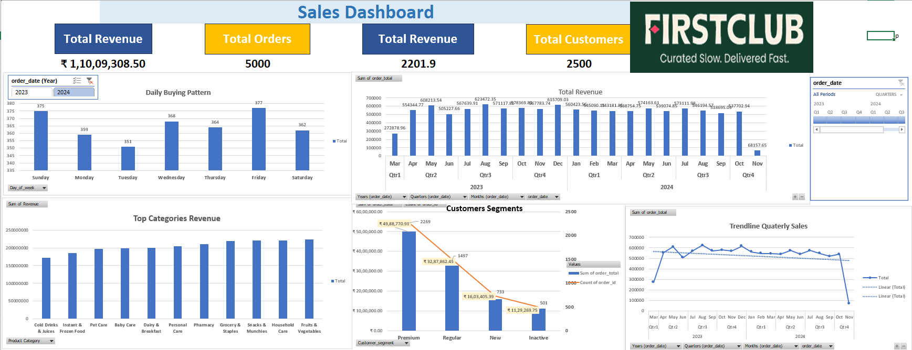
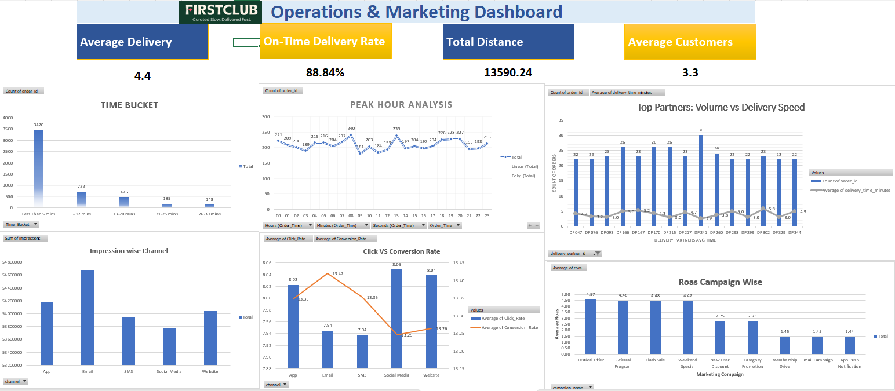

# FirstClub — Quick Commerce Sales & Operations Dashboard

FirstClub is a quick-commerce concept built around getting everyday essentials to customers quickly. For this project, I explored order, delivery, customer, product, and marketing data to get a clearer picture of how the business is performing and where it could improve.

I built the dashboards in **Microsoft Excel**, using PivotTables, charts, and slicers to bring the main metrics into one place. There are two views: one focused on sales and customer behaviour, and another on delivery operations and marketing performance.

## Dashboard Preview

### 1. Sales Dashboard

### 2. Operations & Marketing Dashboard

## What’s included

- **Sales trends:** Compare revenue over time and see which days and periods are busier.
- **Customer segments:** Compare revenue and order activity across customer groups.
- **Product categories:** See which categories contribute more revenue.
- **Delivery performance:** Review on-time delivery and delivery-time buckets.
- **Peak-hour analysis:** Explore how order activity changes throughout the day.
- **Partner performance:** Compare order volumes with average delivery times.
- **Marketing performance:** Review channel impressions, click/conversion rates, and campaign ROAS.

## A few dashboard metrics

| Metric | Value shown |
|---|---:|
| On-time delivery rate | 88.84% |
| Average delivery metric | 4.4 |
| Total distance | 13,590.24 |
| Average customers metric | 3.3 |
| Total orders | 5,000 |
| Total customers | 2,500 |

*Figures are shown as displayed in the workbook. The field definitions and units should be checked before interpreting metrics such as average delivery, total distance, and average customers.*

## What stood out to me

- Delivery time is worth looking at alongside order volume; a high-volume delivery partner is not necessarily the fastest.
- Breaking orders into delivery-time buckets makes it easier to see which delivery windows account for most orders.
- Peak-hour patterns can help with planning delivery capacity and staffing.
- Impressions alone don't tell the whole marketing story, so it's useful to compare channels with click/conversion metrics and campaign ROAS.
- Viewing sales, customers, delivery, and marketing together makes it easier to spot trade-offs and decide what to investigate next.

## Tools used

- Microsoft Excel
- PivotTables and PivotCharts
- Slicers and interactive filters
- KPI cards and dashboard charts

## Files

- `FIRSTclubQuickCOMM_data.xlsx` — workbook with the data and dashboards.
- `dashboard-sales.png` — sales dashboard screenshot.
- `dashboard-operations-marketing.png` — operations and marketing dashboard screenshot.

## How to explore the project

1. Open `FIRSTclubQuickCOMM_data.xlsx` in Microsoft Excel.
2. Use the dashboard filters and slicers to explore different dates and views.
3. Check the supporting sheets to see the data behind the charts.
